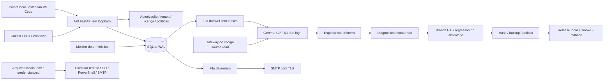

# Arquitetura local e decisões de engenharia

## Contexto que orienta esta versão

Os dois documentos originais propõem uma plataforma comercial multiempresa residente em servidor. As instruções posteriores do proprietário priorizaram uma estação Windows ligada, uma pasta dentro do código-fonte, PowerShell, integração com VS Code, uso do Codex já autenticado e ausência de chave de API dedicada. Esta versão implementa essa fundação local. Comercialização em SaaS, cobrança, autenticação empresarial e manutenção autônoma de qualquer aplicação continuam como evolução, sem serem anunciadas como prontas.

## Componentes e fronteiras

O núcleo é um monólito modular com três loops supervisionados: monitor, worker de investigações e notificações. A operação local não justifica impor Redis, Kubernetes ou PostgreSQL à estação do proprietário. Persistência, autorização e contratos estão separados para uma futura implantação de servidor, que exigirá migração de dados, autenticação empresarial e testes próprios.

## Persistência e isolamento

- SQLite em WAL, transações curtas e bloqueio exclusivo do processo servidor. Migração inicial idempotente em `guardian/db.py`, registrada em `schema_versions`.
- Recursos são consultados por `tenant_id` e identificador. Identidade vem da credencial; o cliente HTTP não pode escolher outro tenant na requisição.
- Credenciais aleatórias de alta entropia têm somente o hash SHA-256 no banco. Papéis: `owner`, `viewer`, `agent`, `source_reader`, `ticket`.
- Agentes e chaves de código têm escopo de ambiente. A chave de código expira em 30 dias e pode ser revogada. Não concede execução, deploy ou leitura da central administrativa.
- Jobs têm estado, tentativas, disponibilidade, proprietário e lease. A lease de 1800 segundos cobre duas sessões de IA de até 360 segundos. Falhas recebem backoff e até três tentativas.
- Releases com lease expirada não são repetidas automaticamente: exigem reconciliação. O executor local também reivindica o estado transacionalmente antes de publicar.
- Incidentes são deduplicados por ambiente e fingerprint. Depois do encerramento, nova ocorrência abre outro incidente.

## Gerente e especialistas

O gerente recebe somente um contexto limitado de evidências saneadas. Sua sessão faz a triagem. Uma segunda sessão é criada com papel de segurança, PHP/Moodle, infraestrutura, banco ou qualidade. O estado da tarefa especializada é persistido em `specialist_tasks` e auditado.

Regra de segurança e palavras indicadoras de incidente sensível encaminham para segurança, independentemente de uma tentativa do gerente de classificá-lo como QA. Segurança e banco recebem risco alto. Essa regra impede aprovação automática de baixo risco; não comprova, por si só, que ocorreu uma invasão.

Os únicos modelos autorizados são `gpt-6.1-sol` e `gpt-6-astra`, com esforço `high`, `xhigh` ou `max`. Gerente/QA usam Sol por padrão; segurança/banco usam Astra. Os identificadores foram conferidos na documentação oficial e no catálogo local do Codex. A execução fixa `--model` e `model_reasoning_effort` e não reduz silenciosamente para outra família. [Modelos oficiais](https://developers.openai.com/api/docs/models).

O Codex roda em modo não interativo, `read-only`, com configuração de usuário e regras adicionais não carregadas. O login da conta é preservado. O produto pede análise somente dos dados fornecidos e não oferece ao modelo um endpoint de shell bruto. A sandbox do Codex não substitui uma máquina/contêiner dedicado para código hostil: o provedor continua sendo um processo confiado ao perfil local. Não apresentar essa fronteira como isolamento contra administradores ou como garantia de ausência de prompt injection.

## Código, credenciais e executores

A aplicação original não importa o Guardian e não depende dele para atender alunos. O diretório é auxiliar. O VS Code hospeda uma extensão que exibe o painel, abre terminal nativo e documentos de contexto. O produto não redistribui uma cópia embutida do VS Code nem simula digitação no chat.

O componente de conexão lê `.env` e `credenciais.md` apenas na raiz cadastrada. Reconhece campos estruturados e um conjunto explícito de rótulos em português. Chaves e passwords são usadas pelos adaptadores locais; não são retornadas no inventário do painel ou nos prompts. O saneamento é heurístico e não deve ser a única barreira para informações reguladas.

SSH executa um comando fixo de leitura. PowerShell executa exclusivamente o script de snapshot incluído. Não há API “execute shell”. As ações de banco, armazenamento R2 e publicação remota não foram habilitadas apenas porque suas credenciais existem.

O gateway de código tem raiz fixa, tipos de arquivo permitidos, limites de arquivos/tamanho, bloqueio de traversal e links que escapam da raiz. `.env`, arquivos de credenciais e diretórios internos são excluídos. O conector consumidor guarda o token por DPAPI no Windows e usa HTTPS ou túnel por loopback. Ter a chave não torna um servidor sem conector acessível: é necessária uma instalação autorizada do gateway junto ao código.

## Pipeline executável e seus limites

O pipeline de alteração implementado é o laboratório Python fornecido. O código é corrigido em worktree e branch exclusivos; a IA pode alterar somente uma função de strings em `app.py`, com AST limitado. Os três testes de regressão confiáveis ficam fora do worktree da IA. Código de clientes não é executado no host por esse runner.

O pacote recebe hash, commit, saída real dos testes e backup por release. O executor verifica política, suspensão, hash do pacote, integridade do backup e versão-base antes da publicação. Depois executa um smoke test e restaura em caso de falha. Reverter código não restaura automaticamente um banco de dados.

Não existe adaptador de produção Moodle validado nesta versão. Descoberta Moodle e diagnóstico não equivalem a homologação ou implantação. Docker está instalado nesta estação, mas seu daemon estava indisponível no levantamento; nenhum gate de contêiner foi falsamente declarado aprovado.

## Licença e autoria

O titular informado é Carlos Antonio de Oliveira Piquet. A licença técnica usa Ed25519, chave pública distribuída e chave privada mantida no perfil do emissor, protegida por DPAPI nesta estação. A edição local de desenvolvimento do autor é identificada explicitamente. Instalações de terceiros iniciam sem licença.

A licença comercial vincula documento final, hash, instalação, fingerprint do dispositivo/usuário, tenant, capacidades e validade. O emissor confere a assinatura gov.br ou o reconhecimento cartorial e então assina o arquivo de licença. O software verifica a assinatura do emissor e o hash do PDF; não substitui o VALIDAR/ITI, o tabelião ou verificação de identidade. Não foi emitido certificado notarial ou ICP-Brasil por este projeto.

## Evolução necessária antes da oferta comercial

Autenticação OIDC/MFA; TLS e cookies seguros de uma central pública; runners separados por cliente; PostgreSQL com políticas de isolamento; secret manager; conectores de release por stack; backups/restauração reais; canários; monitor independente; retenção/exportação; revogação de licença distribuída; instaladores assinados; pagamentos, planos e quotas comerciais. O código-fonte acessível a um administrador local não é inviolável; assinatura de binários e operação de emissão separada são camadas adicionais necessárias.

## Ajustes finais de operação

Sistemas agrupam ambientes de uma organização e possuem abas independentes no painel. A migração 2 acrescenta a associação de sistema. O gerente recebe, quando aplicável, contexto limitado dos projetos explicitamente associados. A revisão automática genérica a cada três horas foi removida. Somente incidentes, pedidos do operador e as duas janelas diárias de inteligência global acionam IA. Veja SEGURANCA_GLOBAL_E_ALERTAS.md.

O adaptador Codex final também desabilita ferramentas de shell, visualização e geração de imagens durante o diagnóstico. Recebe ambiente de processo limitado por allowlist e envia somente dados preparados pelo Guardian; os executores registrados fazem as operações locais. O aceite real foi repetido com essa configuração.
